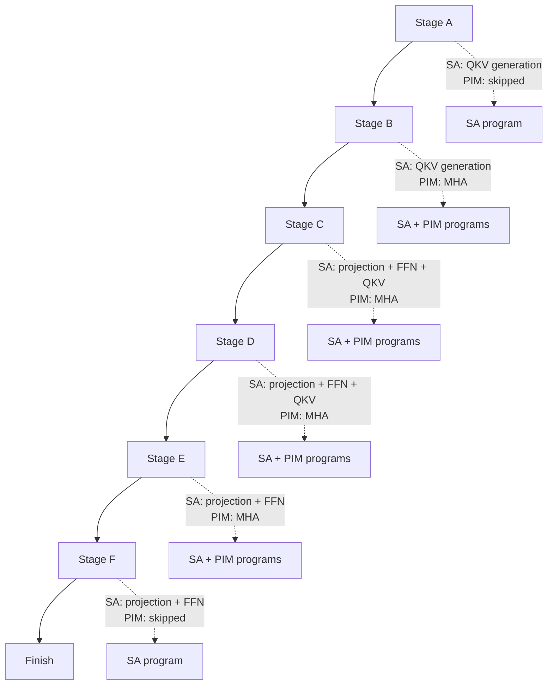

# NeuPIMs Modular Data-Flow Diagram

This document describes the simulator's end-to-end data flow. Solid arrows carry
data or work items. Dashed arrows carry completion, readiness, or timing
feedback. A module waits whenever its input queue is empty, its dependency is
unfinished, or its target resource cannot accept more work.

## 1. Complete data-flow diagram

```mermaid
flowchart LR
    classDef source fill:#E8F1FF,stroke:#2563EB,color:#111827
    classDef control fill:#FFF7ED,stroke:#EA580C,color:#111827
    classDef compute fill:#ECFDF5,stroke:#059669,color:#111827
    classDef memory fill:#F5F3FF,stroke:#7C3AED,color:#111827
    classDef result fill:#F0FDFA,stroke:#0F766E,color:#111827
    classDef wait fill:#FEF2F2,stroke:#DC2626,color:#111827

    A["Dataset / CSV request trace<br/>row[0] input tokens, row[1] channel"]:::source
    B["RequestGenerator<br/>parses CSV rows"]:::control
    C["Client<br/>arrival cycle + InferRequest"]:::control
    D["Client waiting queue"]:::wait
    E["Scheduler request queue<br/>admission, channel, KV allocation"]:::control
    F["Active request queues<br/>per DRAM channel"]:::control
    G["Batch / sub-batch grouping<br/>SA batch + PIM batch"]:::control
    H["StageProgram<br/>operation graph + tensor dependencies"]:::control
    I["Executable operations<br/>only when all input tensors are produced"]:::wait
    J["Tile and Instruction queues<br/>MOVIN/MOVOUT, GEMM, vector, PIM commands"]:::compute
    K["NeuPIMSystolicWS / Core<br/>SRAM, accumulator SRAM, pipelines"]:::compute
    L["MemoryAccess queues<br/>READ/WRITE/GWRITE/COMP/READRES"]:::memory
    M["SimpleInterconnect<br/>core-to-memory and memory-to-core"]:::memory
    N["NewtonSim PIM/DRAM<br/>channels, banks, timing, power"]:::memory
    O["Memory responses<br/>filled SRAM or completed tile counters"]:::memory
    P["Operation / stage completion<br/>next operation or next stage becomes ready"]:::control
    Q["Scheduler completed-request queue"]:::control
    R["Client response<br/>completed cycle and request latency"]:::result
    S["Statistics and logs<br/>latency, stalls, bandwidth, PIM cycles"]:::result

    A -->|"CSV row"| B
    B -->|"input_size, channel"| C
    C -->|"InferRequest{id, arrival_cycle, generated, ...}"| D
    D -->|"pop_request() on core cycle"| E
    E -->|"initiated request + K_cache/V_cache"| F
    F -->|"InferRequest references"| G
    G -->|"BatchedRequest vectors"| H
    H -->|"BTensor graph and model weights"| I
    I -->|"ready Operation"| J
    J -->|"Tile"| K
    K -->|"MemoryAccess"| L
    L -->|"queued request after icnt_latency"| M
    M -->|"accepted by channel"| N
    N -->|"READ/READRES response"| M
    M -->|"response"| O
    O -->|"SRAM fill / remaining counter decrement"| K
    K -->|"finished Tile"| P
    P -->|"finish_tile(), produced tensors"| H
    P -->|"stage/request completion"| Q
    Q -->|"InferRequest with generated == output_size"| R
    C -.->|"arrival_cycle"| S
    N -.->|"DRAM/PIM cycles and BW"| S
    K -.->|"compute and memory stalls"| S
    P -.->|"stage done cycle"| S
    R -.->|"completed_cycle - arrival_cycle"| S

    D -.->|"wait: no admission yet"| E
    E -.->|"wait: max active requests, channel/KV capacity"| F
    I -.->|"wait: input tensor not produced"| H
    J -.->|"wait: dependency or tile unavailable"| K
    K -.->|"wait: SRAM/double-buffer/resource conflict"| J
    L -.->|"wait: interconnect or memory queue"| M
    M -.->|"wait: destination busy"| N
    N -.->|"wait: WillAcceptTransaction=false"| M
    O -.->|"wait: response not returned"| K
    P -.->|"wait: SA/PIM program still has tiles"| H
```

## 2. Module contracts

| Module | Receives | Produces | Waits for |
|---|---|---|---|
| `RequestGenerator` (`src/RequestGenerator.cc`) | CSV path | `(input_size, second_column)` | More CSV rows |
| `Client` (`src/client/Client.cc`) | Parsed trace values | `InferRequest` with `id`, arrival cycle, `input_size`, channel, and `output_size` | Request queue capacity and completion |
| `Scheduler` (`src/scheduler/Scheduler.cc`) | `InferRequest` | Active per-channel queues, KV-cache tensors, `BatchedRequest` | Admission limit, channel assignment, KV/PIM capacity |
| `StageProgram` (`src/StageProgram.cc`) | Model, batch, stage, platform | `Operation` graph and `Tile` work | Input tensors produced; prior stage complete |
| `Operation` (`src/operations/Operation.*`) | `BTensor` inputs and model parameters | Output tensors and tiles | `input->get_produced()` for every input |
| `Core` / `NeuPIMSystolicWS` (`src/Core.cc`) | SA/PIM tiles and instructions | SRAM fills, compute results, finished tiles | Double-buffer availability, source SRAM hits, pipeline completion |
| `SimpleInterconnect` (`src/Interconnect.cc`) | `MemoryAccess` requests/responses | Delivered memory traffic | `finish_cycle`, round-robin turn, destination busy state |
| `PIM` / NewtonSim (`src/Dram.cc`) | DRAM/PIM `MemoryAccess` | Completed memory/PIM responses | `WillAcceptTransaction()` and DRAM/PIM command timing |
| `Simulator` (`src/Simulator.cc`) | All module queues | Cycle ordering and transfers | Core, interconnect, and DRAM cycle masks |
| `Stats` / loggers | Completion and timing counters | Stage, bandwidth, stall, latency, and power logs | End of interval, stage, or simulation |

## 3. Data types passed between modules

| Data item | Meaning | Main consumers |
|---|---|---|
| CSV row | Request-level token lengths and optional channel assignment | `RequestGenerator`, `Client` |
| `InferRequest` | Mutable request state: arrival, generation progress, channel, KV-cache references | `Client`, `Scheduler`, `BatchedRequest` |
| `BatchedRequest` | A group of request references used to build a program | `Scheduler`, `StageProgram` |
| `NPUTensor` | Activations, weights, biases, and query tensors | SA operations and SRAM mapping |
| `PIMTensor` | Key/value cache tensors mapped to a DRAM channel | PIM attention operations |
| `BTensor` graph edge | Produced/consumed tensor dependency | `Operation`, `StageProgram` |
| `Tile` | Tiled unit of an operation, including platform, counters, and instructions | Scheduler and Core |
| `Instruction` | Compute, SRAM, or PIM command inside a tile | Core pipelines |
| `MemoryAccess` | Addressed memory transaction with request type, parent tile, and stage platform | Core, interconnect, NewtonSim |
| Response `MemoryAccess` | Completed read/write/PIM result returned to the parent tile | Interconnect, Core |

## 4. Waiting and back-pressure rules

1. **Client to scheduler:** `Client` creates requests in its waiting queue. The
   simulator transfers them to the scheduler during a core cycle.
2. **Scheduler admission:** a request remains pending when the active-request
   limit, batch limit, channel selection, or KV-cache capacity prevents
   admission.
3. **Operation graph:** `Operation::check_executable()` blocks an operation
   until every input `BTensor` reports `produced`.
4. **Core issue:** `Simulator` calls `Core::can_issue()` before issuing a
   systolic-array tile and `can_issue_pim()` before issuing a PIM tile.
5. **SRAM dependency:** compute instructions wait in the execution queue until
   `Core::can_issue_compute()` finds every source address in the selected SRAM
   or accumulator SRAM buffer.
6. **Interconnect:** each request gets a `finish_cycle`; requests are delayed
   by configured interconnect latency, per-source ordering, round-robin
   arbitration, and a busy destination.
7. **DRAM/PIM admission:** the simulator keeps a request at the interconnect
   boundary while `PIM::is_full()` reports that NewtonSim cannot accept it.
8. **Memory response:** a tile cannot finish while its load or store counters
   are nonzero. Returned responses fill SRAM or decrement the tile counters.
9. **Stage progression:** the scheduler waits until both SA and PIM programs
   finish before advancing from stage A through F.
10. **Request completion:** the client receives a response only after the
    scheduler has completed the request's required output generation.

## 5. Latency handling

| Latency source | How it is handled |
|---|---|
| Request latency | `completed_cycle - arrival_cycle` in the client/request lifecycle |
| PIM attention estimate | Scheduler estimates MHA cost using `_gwrite_latency` and `_gemv_latency` based on sequence length, pages, banks, heads, and tiles |
| Channel imbalance | Estimated request latency is accumulated per DRAM channel; channel-load balancing selects the least-loaded eligible channel |
| Sub-batch imbalance | Scheduler partitions requests into SA and PIM sub-batches using the per-request latency list |
| NPU compute latency | Core pipelines use instruction `start_cycle`/`finish_cycle`; tile counters prevent early completion |
| SRAM and memory stalls | Core tracks load, store, compute-memory, vector-memory, LayerNorm, Softmax, Add, and GELU stall cycles |
| Interconnect latency | `SimpleInterconnect` adds configured `icnt_latency` and serializes requests at each source |
| DRAM/PIM latency | NewtonSim advances on every DRAM cycle and models command timing, queueing, bandwidth, and PIM operations |
| Stage latency | Simulator records stage completion cycle, PIM cycles, and average memory-bandwidth utilization |
| Measurement output | `Stats`, `PIM::print_stat()`, `StageStat`, and operation logs expose timing and utilization results |

### Current request-field behavior

`RequestGenerator::get_qa_length()` returns CSV column `0` and the configured
`answer_index` (`1`). In the current `Client` implementation, those values are
stored as `input_size` and `channel`, while `output_size` is explicitly set to
`1` rather than using the second CSV value as an output-token count.

## 6. Stage and platform view

With sub-batch mode enabled, the scheduler alternates which request group is
assigned to the systolic-array (`SA`) and PIM programs for a stage. With
sub-batch mode disabled, memory requests use one interconnect queue and the
stage sequence skips the alternating PIM stages as implemented in
`Scheduler::refresh_stage()`.

## 7. Implementation note

The configured `neupims` scheduler selects `NeuPIMScheduler`, but the current
`NeuPIMScheduler::cycle()` implementation contains `assert(0)` before calling
the base scheduler cycle. This is a source-level execution caveat, not a
data-flow rule; debug builds can stop there until that assertion is removed or
the subclass is completed.
